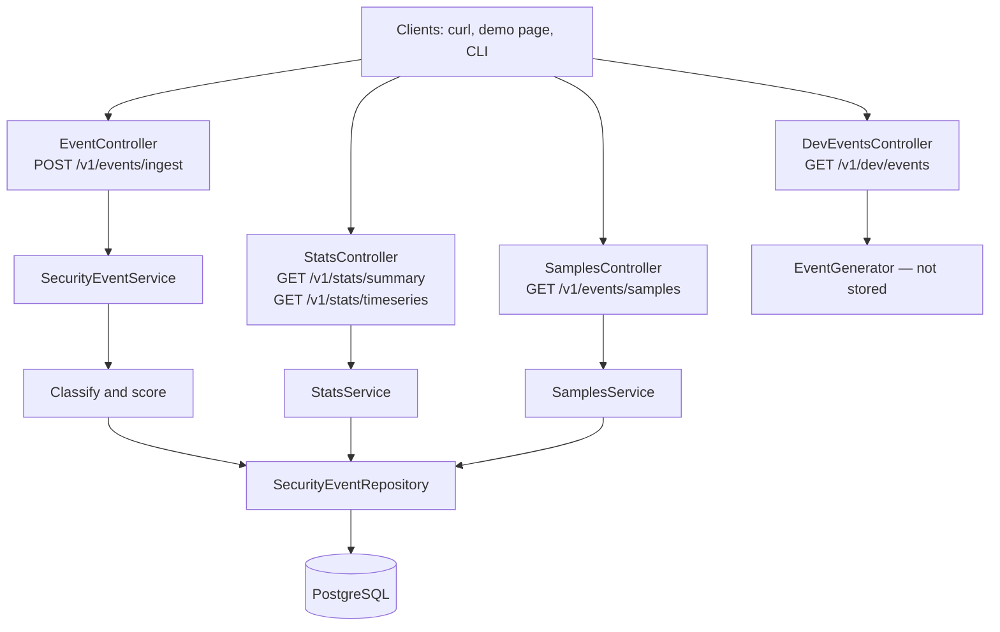

# Mini WSA

[](https://github.com/tzachfi/mini-wsa-tzach-finkelstein/actions/workflows/ci.yml)

**Needs:** Docker.

```bash
docker compose up --build
```

Open [http://localhost:8080](http://localhost:8080/).

Mini Web Security Analytics pipeline — a simplified Akamai WSA service that ingests security events (DLRs), classifies and enriches them, and exposes analytics APIs.

Context: coordinated campaign **Operation Shadow Flood** (SQL injection probes, credential stuffing bots, slow-rate DDoS). SOCs are flooded with raw Data Log Records; this service turns them into scored, queryable analytics.

## Tech stack

- Java 21
- Spring Boot 3.4
- Spring Web, Spring Data JPA, Bean Validation
- PostgreSQL 16 (primary store)
- H2 (ingest slice tests)
- Testcontainers PostgreSQL (stats, samples, and timeseries API integration tests; skipped without Docker)
- Springdoc OpenAPI (Swagger UI)
- Docker / Docker Compose

## Prerequisites

- JDK 21
- Maven 3.9+ (or the included `./mvnw` wrapper)
- Docker Desktop (for `docker compose up` and the Postgres tests during `./mvnw verify`)

## CI

GitHub Actions (`.github/workflows/ci.yml`) runs `./mvnw -B verify` on pushes to `main` and on pull requests targeting `main` / `master`. A second job, `compose-smoke`, runs `docker compose up --build -d --wait`, then posts one ingest event and queries `GET /v1/stats/summary`.

## How to build & run

### Local (Maven + Postgres)

`./mvnw spring-boot:run` uses `localhost:5432` from `application.yml` (override with `DB_URL`). Compose Postgres is internal-only unless you opt in:

```bash
make db
./mvnw spring-boot:run
```

`make db` publishes `${DB_PORT:-5432}` via `docker-compose.db.yml`. Use any Postgres with database/user/password `miniwsa`. `psql` from the host is `docker compose exec postgres psql -U miniwsa -d miniwsa`.

```bash
./mvnw verify
```

Postgres integration tests (`*IT`) need Docker and are skipped without it. `./mvnw package` runs unit tests only and needs a JDK.

The API listens on `http://localhost:8080`.

### Full stack (Docker Compose)

```bash
docker compose up --build
```

To run the demo again from a clean database (seeded `eventId`s return 409 otherwise):

```bash
docker compose down -v
```

Postgres stays on the Compose network only (`postgres:5432`). The host mapping that used to fail when 5432 was already allocated is gone. The app still publishes **8080**. If that port is taken:

```bash
APP_PORT=18080 docker compose up --build
```

Make aliases: `make up`, `make down`, `make logs`, `make db`.

The demo page is [http://localhost:8080/](http://localhost:8080/). **Generate and ingest** calls `GET /v1/dev/events`, then posts each chunk to ingest, then draws `GET /v1/stats/timeseries` as a Chart.js line chart. **Download JSON (no ingest)** is that same GET only — nothing is stored. **Load stats summary**, **Load samples**, and **Load timeseries** call `GET /v1/stats/summary`, `GET /v1/events/samples`, and `GET /v1/stats/timeseries` on the last ingest window (or the last 24 hours). The chart uses Chart.js 4 from jsDelivr (`5m` buckets by default).

### Generate a JSON file (CLI)

The generator has no Spring dependencies. Same `--seed` and `--end` produce byte-identical output. Default seed is **42**. Progress and the attacker summary go to stderr; the JSON array goes to stdout or `-o`.

```bash
./mvnw -q compile exec:java -Dexec.args='--count 10000 --seed 42 --span 24h --end 2026-06-02T00:00:00Z -o events.json'
```

Load a file at or under the live ingest cap (default **1000**, override with `APP_INGEST_MAX_BATCH_SIZE`):

```bash
curl -sS -X POST http://localhost:8080/v1/events/ingest \
  -H 'Content-Type: application/json' \
  --data-binary @events.json
```

Larger files must be sliced. Read the cap from `X-Max-Batch-Size` (do not assume 1000):

```bash
CAP=$(curl -sS -D - -o /tmp/events.json \
  'http://localhost:8080/v1/dev/events?count=10000&seed=42&span=24h&end=2026-06-02T00:00:00Z' \
  | awk 'tolower($1)=="x-max-batch-size:" {print $2}' | tr -d '\r')
i=0
len=$(jq 'length' /tmp/events.json)
while [ "$i" -lt "$len" ]; do
  jq -c ".[$i:$((i + CAP))]" /tmp/events.json \
    | curl -sS -X POST http://localhost:8080/v1/events/ingest \
        -H 'Content-Type: application/json' \
        --data-binary @-
  i=$((i + CAP))
done
```

## Sample data (assignment Part 5)

| Part 5 need | Where it lives |
| --- | --- |
| Realistic mix of categories, actions, and paths | Weighted background events plus pinned attack waves |
| Repeat-offender / campaign waves | Showcase IPs `203.0.113.10`–`.12` and ~20% returning wave IPs |
| Reproducible dataset | Seeded RNG; `eventId` is `evt-s{seed}-{index}` |
| Configurable volume | `--count` / page count (CLI and GET: 148–100000; page caps at 20000) |
| Load through the real ingest API | Demo page chunks on `X-Max-Batch-Size`; CLI writes a file for curl |
| Demo without extra Compose services | Static `index.html` on `:8080` |

A default 10k-event run has 50 wave IPs. Ranks 1–3 of `topAttackers` are always 40, 36, then 30 events (`203.0.113.10` two bursts on `/admin/users`, `.11` one burst on `/api/v1/login`, `.12` two bursts on `/api/v1/login`). `topTargetedPaths` starts at `/api/v1/login` (66) then `/admin/users` (40). Background IPs stay at most 4 events so they never enter the top 10.

## API docs

Interactive contract: [Swagger UI](http://localhost:8080/swagger-ui.html). Machine-readable: [OpenAPI JSON](http://localhost:8080/v3/api-docs).

### Generate — `GET /v1/dev/events`

```bash
curl -sS 'http://localhost:8080/v1/dev/events?count=148&seed=42&span=24h&end=2026-06-02T00:00:00Z'
```

### Ingest — `POST /v1/events/ingest`

```bash
curl -sS -X POST http://localhost:8080/v1/events/ingest \
  -H 'Content-Type: application/json' \
  -d '[{ "eventId": "evt-00133", "timestamp": "2026-05-20T14:32:10Z", "configId": 14227, "clientIp": "203.0.113.42", "path": "/login", "rule": { "severity": "HIGH", "category": "BOT" }, "action": "ALERT" }]'
```

### Stats — `GET /v1/stats/summary`

```bash
curl -sS 'http://localhost:8080/v1/stats/summary?configId=14227&from=2026-06-01T00:00:00Z&to=2026-06-02T00:00:00Z'
```

### Timeseries — `GET /v1/stats/timeseries`

```bash
curl -sS 'http://localhost:8080/v1/stats/timeseries?configId=14227&from=2026-06-01T00:00:00Z&to=2026-06-01T01:00:00Z&interval=5m'
```

### Samples — `GET /v1/events/samples`

```bash
curl -sS 'http://localhost:8080/v1/events/samples?configId=14227&from=2026-06-01T00:00:00Z&to=2026-06-02T00:00:00Z&category=INJECTION&action=DENY&limit=20&offset=0'
```

## Architecture

Layered Spring Boot service: `Controller` → `Service` → `Repository` → PostgreSQL.

Packages: `config`, `controller`, `dto`, `model`, `repository`, `service`, `enrichment`, `exception`, `generator`.



Ingest writes `attackType`, `threatScore`, and `receivedAt` before `saveAll`.

## Storage justification

why PostgreSQL

Every query here has the same shape: filter by config and time range, then group and count. PostgreSQL handles that well at this scale. It also gives me for free:
- a unique `event_id` constraint, which rejects duplicates with 409
- transactions, so a batch is written all-or-nothing
- SQL aggregation, so stats are computed in the database instead of in Java

**Indexes** put the equality column first and the time range second:
- `(config_id, event_timestamp, id)` and `(event_timestamp, id)` serve summary and samples, with and without `configId`. Because they're already time-ordered, a `DESC LIMIT` page needs no sort, and `id` keeps pagination stable when timestamps collide.
- `(client_ip, event_timestamp)` serves the repeat-offender check at ingest.

**Not indexed, on purpose:**
- `path` is only grouped after the time filter has already narrowed the rows.
- `action` and `category` have too few distinct values for an index to help.
- Every extra index slows inserts.

**Testing:** ingest tests run on H2 for speed. Stats, samples, and timeseries run against real Postgres via Testcontainers (`./mvnw verify`); they are skipped when Docker is missing.

**At real scale**, stats cost grows with the number of events in the range. The next steps would be time partitioning, then rollups (or TimescaleDB continuous aggregates), then a columnar store like ClickHouse. Only the repository layer would change.

## Git tags / milestones

| Tag | Meaning |
| --- | --- |
| `v0.0-infrastructure` | Project scaffold, Docker/Postgres, base config |
| `v0.1-ingestion` | `POST /v1/events/ingest` + validation + `receivedAt` |
| `v0.2-enrichment` | Attack classification + `ThreatScoreCalculator` |
| `v0.3-stats` | `GET /v1/stats/summary` (JPQL aggregations) |
| `v0.4-samples` | `GET /v1/events/samples` pagination and filters |
| `v0.5-generator` | Seeded event generator, CLI, demo page, `GET /v1/dev/events` |
| `v0.6-timeseries` | `GET /v1/stats/timeseries` (UTC calendar buckets) |

## Challenges and how they were solved
- Repeat offender detection inside a bulk batch: 
what was the problem: detecting repeat in a naive approach (COUNT against the db) can miss a repeat offender as it doesn't check against the events in the input array and doesn't store at the db yet.
what was the solution: the count combines two sources: matching events already stored in the database, and earlier same IP events in the current batch, counted in memory. The window is inclusive `[timestamp − 10 minutes, timestamp]`. 

- Repeat offender cost grew with the noisiest IPs:
what was the problem: each IP's timestamps were loaded over one wide window and rescanned for every event, so the busiest IPs (the actual attack waves) were the slowest to score.
what was the solution: the query returns timestamps sorted, so each event's count is a binary search, and the window is computed per IP so one old event doesn't widen the read for everyone.

- Batch inserts were silently row by row:
what was the problem: with IDENTITY id generation, Hibernate needs each id back right after the insert, which disables JDBC batching, so a 1,000 event batch meant 1,000 round trips to the db.
what was the solution: switched to a pooled sequence (allocation size 50) with Hibernate batching enabled, so ids are pre-allocated in memory and the inserts go out in batches.

## What I’d improve given more time

- Repeat offender check at scale:
today the check queries the db, and it gets slower the more events an IP sends. at scale i'd send events through Kafka keyed by clientIp, so each IP always lands on the same consumer, and keep a simple per-IP count of the last 10 minutes in memory there. no db lookup, same cost for every event.

- Pre-aggregation for stats: stats count every raw event in the range, so they slow down as data grows. i'd keep hourly totals per config, category and action, updated on ingest, and only count raw events for the partial hours at the edges.

- Async ingestion: put a queue (Kafka) between the API and the db, so traffic spikes don't hit the db directly.
